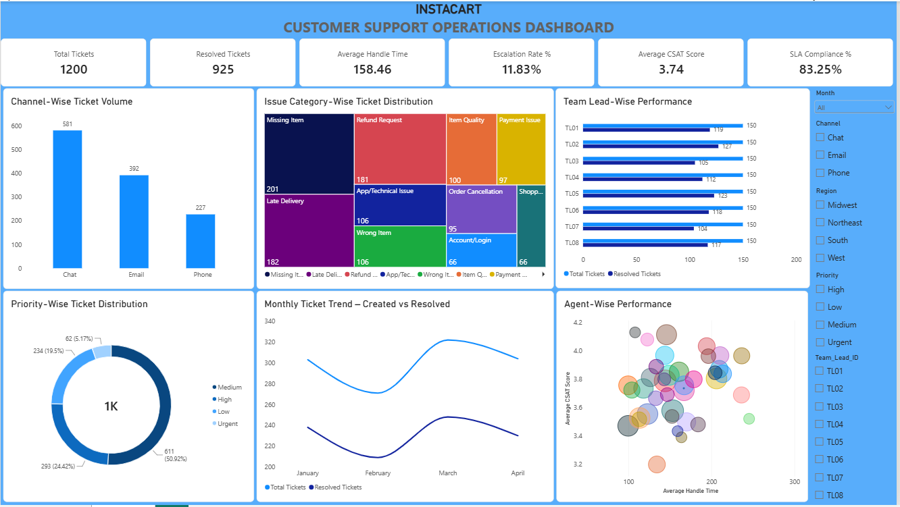

**Power BI – Customer Support Operations Dashboard**

**Project Overview**

This project focuses on analyzing customer support operations using Microsoft *Power BI*. The dashboard provides insights into ticket volume, resolution performance, agent productivity, customer satisfaction, escalation rates, and SLA compliance.

**Tools & Technologies**

*Microsoft Power BI*

*DAX (Data Analysis Expressions)*

*Power Query*

*Data Visualization*

*Data Modeling*

**Key Performance Indicators (KPIs)**

The dashboard includes six key performance indicators:

*Total Tickets – Total number of support tickets received.*

*Resolved Tickets – Total number of tickets resolved.*

*Average Handle Time – Average time taken to handle customer support tickets.*

*Escalation Rate (%) – Percentage of tickets escalated.*

*Average CSAT Score – Average customer satisfaction score.*

*SLA Compliance (%) – Percentage of tickets meeting service-level agreements.*

**Dashboard Visualizations**

Six different visualizations were developed to analyze customer support performance:

*Channel-Wise Ticket Volume – Clustered Column Chart*

*Issue Category-Wise Ticket Distribution – Treemap*

*Priority-Wise Ticket Distribution – Donut Chart*

*Monthly Ticket Trend – Created vs Resolved – Line Chart*

*Team Lead-Wise Performance – Clustered Bar Chart*

*Agent-Wise Performance – Scatter Chart*

**DAX & Data Analysis**

Created DAX measures to calculate:

*Total Tickets*

*Resolved Tickets*

*Average Handle Time*

*Escalation Rate*

*Average CSAT Score*

*SLA Compliance*

These measures support KPI reporting and interactive analysis across the dashboard.*

**Interactive Features**

The dashboard enables performance analysis through different visualizations and interactive filtering.

**Key Business Objectives**

*Monitor overall customer support ticket volume.*

*Compare ticket distribution across different support channels.*

*Identify frequently reported issue categories.*

*Analyze ticket priority distribution.*

*Compare ticket creation and resolution trends.*

*Evaluate Team Lead and agent performance.*

*Monitor customer satisfaction and SLA compliance.*

**Project Files**

Customer_Support_Dashboard.pbix – Power BI dashboard file.

Customer_Support_Dashboard_Preview.png – Dashboard

**Conclusion**

This project demonstrates the use of Power BI, DAX measures, and data visualization techniques to analyze customer support operations and convert ticket-level data into meaningful operational insights.
